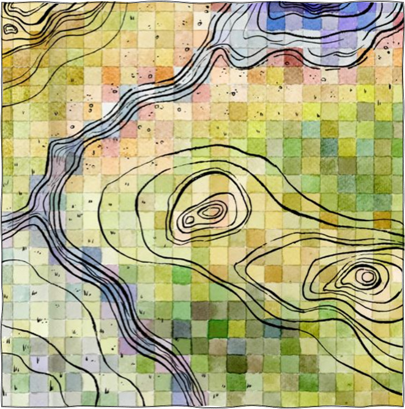

::: {.hero}

::: {.hero-copy}
I am an ecologist with The Nature Conservancy's LANDFIRE team. I publish landscape assessments so a forest's history is something you can look at: which ecosystems covered the ground, and how much.

This site collects a few of those pieces. The [Monongahela chart](projects.qmd) is a Biophysical Settings summary. [Wooden Man Weather](https://rswaty.github.io/woodenmanweather/) is a goofy weather dashboard for Marquette, Michigan. A longer professional record is on [LinkedIn](https://www.linkedin.com/in/randyswaty/).
:::

::: {.hero-art}
{fig-alt="Square watercolor painting of a pastel pixel grid crossed by black contour lines, by Leo Barch."}
:::

:::

::: {.work}

## Selected work

::: {.work-grid}

::: {.card}
::: {.card-body}
#### Monongahela National Forest

Historical ecosystems, in acres. Spruce-fir forest covers more of this summary than any other Biophysical Setting.

[View the chart](projects.qmd)
:::
:::

::: {.card}
::: {.card-body}
#### Wooden Man Weather

A weather dashboard for Marquette and the central Upper Peninsula, published as its own Quarto site.

[Open the site](https://rswaty.github.io/woodenmanweather/)
:::
:::

:::

:::
